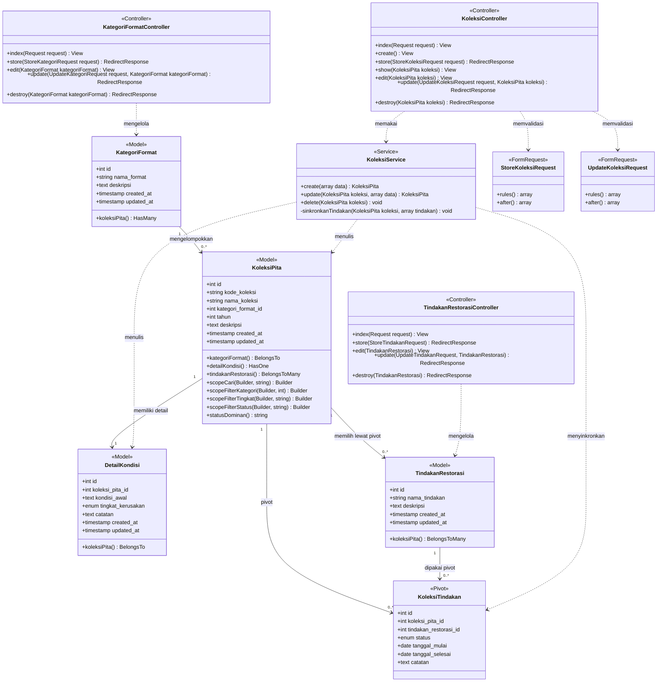

# Class Diagram: Pita Lestari

Diagram kelas berikut menggambarkan model Eloquent, service transaksi, controller resource, dan Form Request yang dipakai aplikasi. Relasi kartu menunjukkan kardinalitas Eloquent, sedangkan garis putus-putus menunjukkan ketergantungan pemakaian.

## Catatan implementasi

- `KoleksiPita` memiliki `hasOne(DetailKondisi)` dan `belongsToMany(TindakanRestorasi)` dengan `withPivot('status', 'tanggal_mulai', 'tanggal_selesai', 'catatan')`.
- `KoleksiService` membungkus penyimpanan koleksi, detail kondisi, dan sinkronisasi pivot dalam `DB::transaction`.
- `StoreKoleksiRequest` dan `UpdateKoleksiRequest` mewarisi aturan dasar dari `KoleksiRequest`, termasuk validasi tanggal per tindakan.
- Controller kategori dan tindakan memakai guard sebelum menghapus data yang masih dipakai.

## Berkas sumber

- Mermaid: `docs/class-diagram.mmd`
- Hasil PNG: `docs/class-diagram.png`
